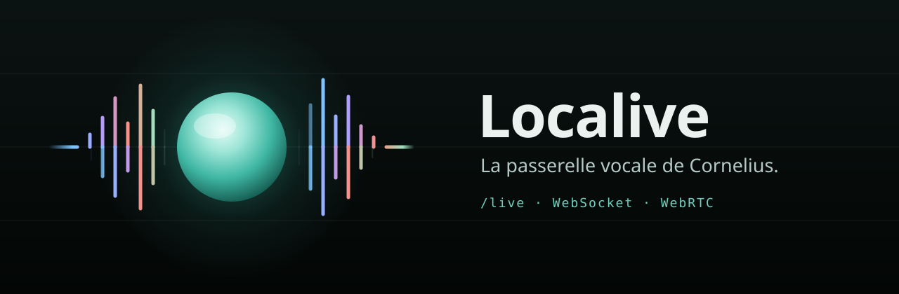

<div align="center">



<h3>Un moteur vocal 100 % local pour Cornelius et vos applications.</h3>

<p><a href="docs/installation.md">Installation</a> · <a href="docs/cornelius.md">Brancher Cornelius</a> · <a href="docs/protocole.md">API Live</a> · <a href="docs/mesures.md">Mesures</a></p>

</div>

Localive reçoit la voix en WebSocket ou WebRTC. Parakeet transcrit la demande, Qwen utilise les outils de votre application et Phonon répond en français. Vous pouvez interrompre la réponse en parlant. Avec un grand catalogue, d3-mini sélectionne les outils utiles à chaque tour.

## 🚀 Démarrer

Prévoyez environ 9 Go pour les modèles. Sous Windows, installez `uv` avec `winget install --id=astral-sh.uv -e`, puis rouvrez PowerShell. Acceptez les conditions de la voix Phonon avec votre compte Hugging Face avant de lancer l’installation. [Accès à Phonon](https://huggingface.co/gradium/phonon-40m-fr) · [Installation sous Linux](docs/installation.md#linux)

```powershell
git clone https://github.com/lfpoulain/localive.git
cd localive
powershell -ExecutionPolicy Bypass -File scripts/setup.ps1
```

Double-cliquez sur **Lancer Localive.cmd**. Dans [l’administration locale](http://127.0.0.1:8787), attendez que le serveur soit prêt.

| Pour essayer sur la même machine | Adresse |
|---|---|
| Dans Cornelius, champ **Serveur Live** | `http://127.0.0.1:8787/v1` |
| Depuis votre client WebSocket | `ws://127.0.0.1:8787/live` |

Pour entendre une première réponse sans écrire de client, envoyez le [WAV de démonstration](docs/protocole.md#essayer-avec-un-fichier-wav). Pour connecter le miroir depuis une autre machine, suivez le [guide réseau de Cornelius](docs/cornelius.md).

## 🔒 Confidentialité

Par défaut, la voix et les réponses sont traitées sur votre machine. Le journal local conserve les transcriptions et des extraits de résultats d’outils. Photon transmet des statistiques techniques à `api.moondream.ai`, sans audio ni texte. La recherche web et les modèles distants optionnels envoient les requêtes aux services choisis.

## 📜 Licence

Le code est distribué sous [PolyForm Noncommercial 1.0.0](LICENSE). Les modèles ont leurs propres conditions.

<details>
<summary>Licences des composants</summary>

| Modèle | Rôle | Licence |
|---|---|---|
| [Phonon 40m-fr](https://huggingface.co/gradium/phonon-40m-fr) | Voix | CC BY-NC 4.0, à conditions |
| [Parakeet Ultra](https://huggingface.co/moondream/parakeet-ultra) via Photon | Transcription | Poids CC BY 4.0 ; moteur Photon et noyaux CUDA propriétaires (M87 Labs) |
| [Qwen3-4B-Instruct-2507](https://huggingface.co/Qwen/Qwen3-4B-Instruct-2507) | Conversation et arbitrage des interruptions | Apache 2.0 |
| [d3-mini Q8_0](https://huggingface.co/ggml-org/vllm-d3-mini-GGUF) | Sélection des outils et raccrochage vocal optionnel | Apache 2.0 |
| [Smart Turn v3.2](https://huggingface.co/pipecat-ai/smart-turn-v3) | Fin de tour | BSD 2-Clause |
| [Silero VAD v5](https://github.com/snakers4/silero-vad) | Détection de voix | MIT (fourni dans `src/localive/assets`) |
| [SearXNG](https://github.com/searxng/searxng) | Recherche web | AGPL-3.0 (image Docker officielle, non modifiée) |

Polices de l'administration : DM Sans, DM Mono et Epilogue, sous SIL Open Font License.

</details>

[Documentation](docs/README.md) · [Cornelius](https://github.com/lfpoulain/Cornelius) · Les Frères Poulain
